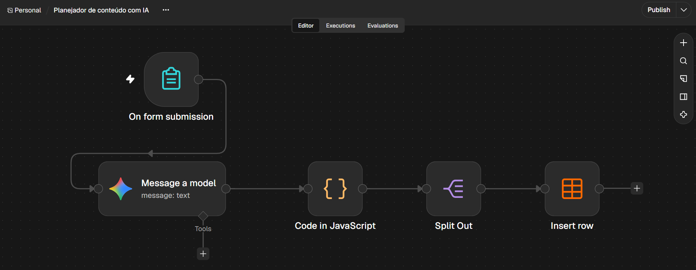
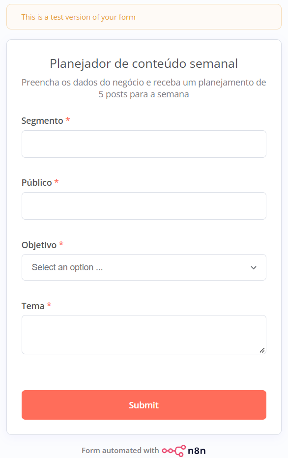
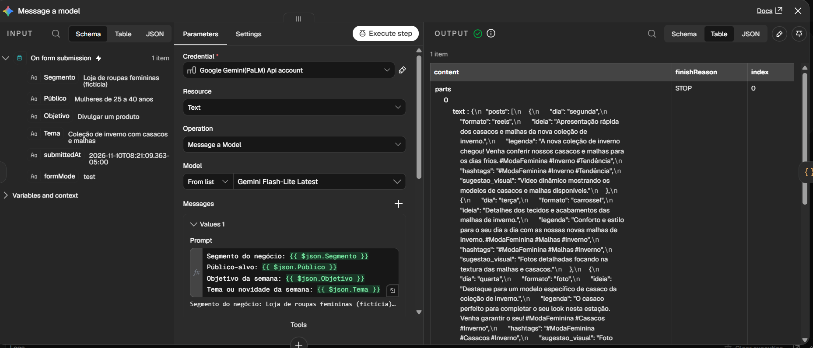
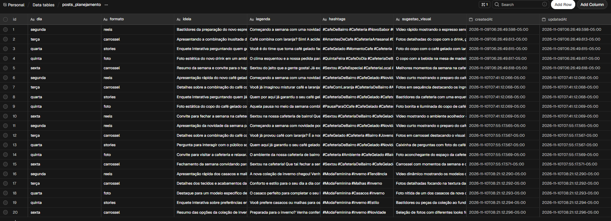

# Planejador de conteúdo semanal com IA (n8n + Gemini)

Fluxo de automação no n8n que recebe os dados de um negócio por um formulário e usa o Gemini para montar um planejamento de 5 posts para Instagram, guardando cada post em uma tabela.

## O que o fluxo faz

1. **Formulário (n8n Form):** recebe segmento, público, objetivo da semana e tema.
2. **Gemini (Message a model):** gera o planejamento em JSON, seguindo uma instrução com regras de formato e de "não inventar dados" (ver `prompt.md`).
3. **Code (JavaScript):** converte a resposta da IA em dados estruturados.
4. **Split Out:** separa os 5 posts em itens individuais.
5. **Data table (Insert row):** grava cada post (dia, formato, ideia, legenda, hashtags e sugestão visual) em uma linha da tabela.

## O que testei

Usei dois negócios fictícios (uma cafeteria de bairro e uma loja de roupas femininas), sem nenhum dado de cliente real. A tabela de exemplo guarda o histórico de 4 rodadas:

| Linhas | Rodada |
|---|---|
| 1 a 5 | Cafeteria, versão inicial |
| 6 a 10 | Cafeteria, depois de acrescentar regras para não inventar dados |
| 11 a 15 | Cafeteria, depois de corrigir o campo "Público" |
| 16 a 20 | Loja de roupas, versão final |

- **Problema 1, invenções da IA:** na primeira versão, a IA citou detalhes que eu não tinha informado (um ingrediente, um diferencial do produto e um evento).
- **Correção:** acrescentei regras à instrução para usar apenas as informações fornecidas. Resultado: as invenções que eu tinha identificado não apareceram mais nas 5 linhas seguintes.
- **Problema 2, campo que não chegava na IA:** o campo "Público" tinha acento no formulário e a expressão do prompt não, então o público-alvo chegava vazio. Corrigi a expressão e rodei de novo.

## Limitações

- Testes feitos com poucos exemplos e dois negócio fictício.
- Não medi o tempo economizado em relação ao planejamento manual, então não faço afirmações sobre isso.
- A IA não responde sempre igual, e o resultado pode variar.
- Os posts precisam de revisão humana antes de publicar.
- A sugestão visual é só uma descrição em texto, o fluxo não cria arte nem publica nas redes sociais.

## Como usar

1. Instale o Node.js (versões 20.19 a 24) e rode `npx n8n`.
2. No n8n, menu do fluxo → **Import from File** → `planejador de conteudo com IA.json`.
3. Crie uma credencial **Google Gemini (PaLM) API** com a sua própria chave.
4. Crie uma Data table `posts_planejamento` com as colunas de texto `dia`, `formato`, `ideia`, `legenda`, `hashtags` e `sugestao_visual`, e selecione-a no último nó.
5. Execute o fluxo e preencha o formulário.

## O que aprendi

- Montar um fluxo com formulário, IA e tabela no n8n.
- Pedir resposta estruturada à IA e tratá-la com código.
- Reduzir invenções da IA ajustando a instrução e verificando o resultado.
- Depurar um erro de nome de campo que deixava um dado fora do prompt.

## Próximos passos

- Medir o tempo de planejamento manual em comparação ao fluxo (incluindo a revisão), com mais de um negócio.
- Campo de tom de voz no formulário (descontraído, profissional, acolhedor).
- Enviar o resultado para uma planilha ou e-mail, em vez de só a tabela do n8n.
